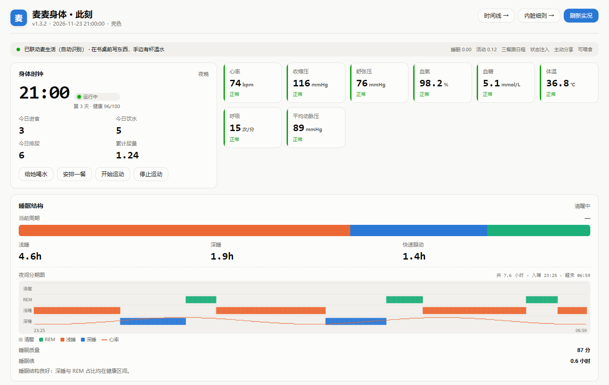

# LifeBody·麦麦身体｜生理仿真引擎

**让麦麦不仅在聊天中存在，还有一副持续运转、会饿会困会生病的身体。**

装上之后，麦麦会有自己的心率、血压、血糖、饥饿曲线、睡眠质量等各种生理指标。根据吃的食物、睡眠质量、运动与否，她的身体会真实地饿、困、累、疼。

心脑电图像 · 生理模型仿真 · 内分泌与受体 · 睡眠周期 · 情绪仿真

[下载安装](https://github.com/ShuangziG/maibot-body-emulator/releases/latest) · [使用手册](https://github.com/ShuangziG/maibot-body-emulator/blob/main/docs/使用手册.md) · [配置指南](https://github.com/ShuangziG/maibot-body-emulator/blob/main/docs/配置指南.md) · [状态 API](https://github.com/ShuangziG/maibot-body-emulator/blob/main/docs/只读状态API.md) · [更新日志](https://github.com/ShuangziG/maibot-body-emulator/blob/main/CHANGELOG.md)

> **启用插件联动功能后，需重启 MaiBot 本体。**
>
> 联动开关只在插件加载时读取一次。在 WebUI 里打开「启用联动」后若不重启，
> 两边插件都显示正常却互不通讯——身体拿不到麦生活的作息与日程。

> **先说三件最要紧的事**
>
> 1. **引擎本体不消耗 token。** 生理计算是纯 Python，只用标准库，不联网、不用 GPU、不调模型。挂多久都不产生费用。
> 2. **唯一的模型调用在「听懂吃了什么」这一步**，而且能关掉（见第八节）。
> 3. **所有医疗数据都是模拟，不能用于医学判断。** 有健康问题请找医生。

---

## 一、你会看到什么

装好之后，宿主（MaiBot）里会多出这些页面：

| 页面 | 内容 |
| --- | --- |
| **麦麦此刻的身体** | 身体时钟、8 项核心体征、8 项体感、状态自述、吃过什么、事件流、近 24 小时曲线、睡眠卡片（含整夜分期图） |
| **体征时间线** | 6 / 12 / 24 / 48 小时生理曲线、按类型筛选的事件流、逐分钟采样回放表 |
| **内脏与食物库** | 实时 ECG 心电与 EEG 脑电仿真、29 个分组共 160 项指标、326 种食物库（可搜索 / 筛选 / 排序）、各餐段的候选菜单 |
| **血液与生活习惯**（v1.4.0 新增） | 血容量与红细胞分账、血红蛋白与携氧、铁与血小板、白细胞三分类与炎症指标、膳食营养结构与质量分、16 项生活习惯判定 |

四个页面都是单文件内联 HTML/CSS/JS，不引用 CDN、不发外部请求，**断网也能正常显示**。

图：「麦麦此刻的身体」页面 —— 8 项核心体征、体感条、胃内容物、最近事件，以及近 24 小时曲线与整夜睡眠分期图。

---

## 二、安装

下载最新 Release，解压到宿主的插件目录，重启 MaiBot 即可。

完整的目录结构、依赖与验证步骤见 **[使用手册 · 安装](https://github.com/ShuangziG/maibot-body-emulator/blob/main/docs/使用手册.md)**。

---

## 三、她的身体里有什么

状态量一共 372 个（v1.4.0 新增 88 个），其中 160 项在「内脏与食物库」里按 29 个分组展示。
分组是按器官分的，每组默认只显示最该看的几个量，其余点「展开」看全量。
另外 45 项指标与 16 项习惯判定在「血液与生活习惯」页，不进器官分组。

| 分组 | 能看到什么 |
| --- | --- |
| 心血管 / 呼吸 | 心率、每搏输出量、心输出量、血压、脉压、循环血量；呼吸频率、潮气量、血氧、二氧化碳 |
| 代谢 / 胰岛 | 血糖、胰岛素、肝糖原、细胞能量、血乳酸；胰高血糖素、淀粉素、生长抑素 |
| 消化道 / 胃肠腺体 | 胃内容物与待排空的糖/蛋白/脂肪、肠内营养；胃泌素、促胰液素、缩胆囊素、GIP、PYY、GLP-1、胃饥饿素 |
| 肾脏 / 肾脏内分泌 / 心脏内分泌 | 滤过率、尿量、膀胱容量、血钠钾、渗透压、血液 pH；肾素、血管紧张素、活性维生素 D；心房钠尿肽 |
| 下丘脑 · 垂体 / 甲状腺 / 甲状旁腺 / 肾上腺 | CRH、TRH、GnRH、ACTH、TSH、FSH、LH、催乳素、催产素、抗利尿激素；T4/T3、降钙素；PTH 与血钙；皮质醇、醛固酮、DHEA、肾上腺素、去甲肾上腺素 |
| 生殖腺 / 松果体 · 皮肤 | 雌二醇、雌酮、雌三醇、孕激素、睾酮；褪黑素、25-羟基维生素 D |
| 血管内皮 · 血小板 / 神经胺类 | 前列环素、血栓素、缓激肽、白三烯；多巴胺、5-羟色胺、腺苷、乙酰胆碱、内源性大麻素 |
| 体温 / 嗜好品 | 核心体温、出汗、寒战、冷热体感；血液酒精浓度、咖啡因浓度 |
| 行为体感 | 饥饿、口渴、压力、疼痛、精力、心境、欣快、烦躁 |
| 受体占据 | 按器官分 9 组共 50 个受体的「被占了多少」（0~1 的比例） |

> **与他插件的边界**：本插件不修改、也不要求任何其他插件适配。当日程插件写出的
> 「胃里空空的」与身体实际的「不饿」冲突时，我们只在自己注入的提示里补一句校正
> （可关闭，默认开）。

### 血液、免疫、膳食营养与生活习惯（v1.4.0 新增）

| 一块 | 能看到什么 | 怎么算的 |
| --- | --- | --- |
| 血液 | 血容量、血浆量、红细胞量、血红蛋白、红细胞压积、氧输送 | 血浆量由总体水导出（守恒），红细胞量独立记账：寿命 120 天、由促红素驱动生成 |
| 失血 | 经期与偶发失血的累计量、凝血进程、血小板 | 经血按人群分布抽（中位 35 mL，>80 mL 属月经过多）；失血同时扣水、钠、红细胞与铁 |
| 免疫 | 中性粒 / 淋巴 / 单核、IL-6、CRP、感染部位、发热驱动 | 细菌感染升中性粒、病毒感染升淋巴；IL-6 → CRP 两级延迟 |
| 膳食 | 今日能量、三大供能比、纤维、钾钙铁维 C、钠、0~100 质量分 | 与成年女性推荐量对齐打分（结构参照 HEI-2015），缺什么/超什么单独列 |
| 生活习惯 | 16 项（9 正向 + 7 负向）当前是否符合 | **纯判定**：从状态反推，不产生任何生理后果 |

四块的机制、阈值与文献依据，连"哪些是估算"都写清楚了，见
**[更新报告 v1.4.0](https://github.com/ShuangziG/maibot-body-emulator/blob/main/docs/更新报告_v1.4.0.md)**。

> 内分泌与受体逐条列在哪一组、名字对应什么，见 **[内分泌系统总表](https://github.com/ShuangziG/maibot-body-emulator/blob/main/docs/内分泌系统总表.md)**。

### 食物库：认得出菜名，也拆得开

| 改了什么 | 现在什么样 |
| --- | --- |
| 三餐候选池 | 不再写「米饭 + 鸡胸肉 + 汤」，而是「米饭+黄焖鸡+紫菜汤」「米饭+红烧肉+海带豆腐汤+炒青菜」 |
| 怎么挑 | 能搜名字（中文或 key 都行）、按分组筛、点表头排序、每页 50 行 |
| 看营养 | 「详表」多出纤维、钾、钙、铁、维 C 五列 |
| 候选池 | 默认折叠，点标题才展开 |
| 基础食材 | 补了食用油、白砂糖、牛肉、羊肉、面条、青菜、鱼肉、猪肝、奶酪、黄油，以及紫菜汤、番茄蛋汤、海带豆腐汤三道汤品 |

为什么值得改：她吃下去的东西只有两种结局 —— 直接命中食物库，或者交给宿主的「工具/utils」小模型拆成食材。
以前拆解表只有 78 个词，蔬菜、油、糖几乎全靠猜；「黄焖鸡米饭」还会被整体当成那道黄焖鸡，
一碗饭（约 230 kcal）就这么没了。现在拆解表 119 个词，「一道菜 + 一份主食」按两件算
（黄焖鸡米饭 = 黄焖鸡 + 米饭），用 Qwen3.5-4B 实测过 8 句常见写法。

---

## 四、没人管的时候她怎么活

不开启日程联动时，她按自己的作息过日子：

- **睡觉**：默认 23:00 上床、07:00 起床（可改）。上床后几分钟内入睡，心率、血压、体温、呼吸一起下移；早上反过来回升。整夜分四段（浅睡 / 深睡 / REM / 清醒），前半夜深睡多、后半夜 REM 多，**每晚有区别**。
- **夜里会醒**：太渴、憋尿、或有人发消息都会被吵醒，醒后要安静一阵才重新睡着。连续清醒太久（约 20 小时）会撑不住直接睡过去。
- **「一整夜」是一个整体**：夜里就算被吵醒几次，只要还在同一晚，都算同一夜，不会因为中断就数成两夜。判断归属看的是**入睡时刻**，所以凌晨 3 点才睡下去仍然归属前半夜那一晚。
- **午睡不进夜间统计**：落在日间、短于 4 小时的小睡单独记为午睡。它不出现在「最近一夜」里，不冒充「昨晚睡了多久」，也不参与睡眠质量评分与睡眠债结算。
- **吃饭**：默认 07:30 / 12:30 / 18:30 三餐，到点就吃、不看饿不饿；饿了才会加餐，睡着不吃、饭点撞进睡眠就跳过。
- **喝水 / 排泄**：口渴了自己喝水；白天和夜里排尿阈值不同；餐后更容易有便意，夜里一般不排便。
- **运动**：精力够、最近睡够、没有酸痛才会去跑；跑完会热、会喘、会出汗，隔天可能肌肉酸痛。
- **月经**（默认关闭）：可按「上次月经第一天」对齐真实日历，行经期会痛、会累，黄体后期睡眠变浅。
- **会生病，但不会死**：健康值掉到很低会病重，开了「自动送医」会被送去住院，出院后慢慢恢复。

---

## 五、怎么跟她互动

三个入口：`body_state` 读身体状态、`body_eat` 记账吃喝、`/body` 在会话里出状态图；另有首页卡 `麦麦此刻的身体`。

`body_eat` 只在「允许聊天喂食」开启时进常驻工具表。关掉这一项，它会被降为 deferred（模型需要
`tool_search` 才能发现，参数说明也不再占每次请求的上下文）——省下约 250 token/次，且不影响任何
其它功能。**改完该项需重载插件**才生效。

参数、示例与注意事项见 **[使用手册 · 怎么跟它互动](https://github.com/ShuangziG/maibot-body-emulator/blob/main/docs/使用手册.md)**。

---

## 六、她会生病，但不会死

健康值是 0–100 的连续量，**没有死亡状态**。掉到 0 只代表状况很糟，休养和治疗能拉回来。

这些开关都在配置面板的 **「急救」** 分组里：

| 开关 | 默认 | 作用 |
| --- | --- | --- |
| 启用自动送医 | 关 | 总开关；关着时健康照算，但不会自动送医 |
| 濒死健康阈值 | 25 | 健康值低于它就算病重 |
| 濒死持续判定 | 600 秒 | 病重持续多久才送医；0 = 立刻送 |
| 住院时长 | 6 小时 | 一次住院待多久 |
| 出院恢复健康值 | 74 | 出院时健康值回到多少 |
| 住院静默时长 | 0 小时 | 住院头几小时不回消息；0 = 不拦 |

流程是：跌破阈值 → 观察期 → 没恢复 → 送医。住院期间给支持治疗，各项体征逐步回到安全区，
健康值向「出院恢复健康值」收敛，然后出院。送医原因会按当时最严重的那一项写，
比如「严重低血糖 2.8 mmol/L」「低氧血症 86%」「循环衰竭 MAP 52」。

**默认关闭。** 防止聊着聊着麦麦进医院了，所以 `enabled = false`：健康值照样计算，但不会自动
送医。想让它在病重时自动送医，把这一项改成 `true` 即可。

---

## 七、和日程插件联动（麦生活 / 麦织，可选）

装了 **麦生活**（`maibot-community.mai-life`）或 **麦织**（`ilworkcn.maiweave`）任意一个，
都可以让身体跟着它真实的日程走。两者互不兼容，装哪个就把「日程引擎」填成哪个。
**默认关闭**，不装也完全能用。

| 开关 | 效果 |
| --- | --- |
| 日程引擎 | **麦织填 `weave`，麦生活填 `life`**。填错则联动一直失败、身体退回独立运行。 |
| 同步作息 | 跟着日程的睡/醒走；关掉就只按内置昼夜节律。 |
| 同步三餐 | 打开后三餐时刻和餐段由日程定；日程摘要里点名的食物会被识别写入。同一顿饭只触发一次，跨重启不重复。 |
| 体征注入对话 | 宿主请求模型前，把当前生理状态压成一句「【你此刻的身体】…」拼进系统消息。**只在有异常项时才注入**，全都正常时不花 token。 |
| 时钟对齐 | 拿日程的钟点校正仿真时间。**仅麦生活**。 |
| 病危时通知麦生活 | 住院或首次濒危时交给它一条主动联系的由头。**仅麦生活**。 |

**麦生活是半双向**：可以读也可以写，但是只能写入基本状态。

**麦织是纯单向**：只有一条只读接口 `get_life_status`，不写入、不改动它任何东西。

麦织的接口是 `get_life_status`（另有一个 `evaluate_behavior` 查询）。下表按**它的源码**逐字段核对
（`docs/只读状态API.md` + `core/engine.py`），不是照文档猜：

| 麦织提供 | 本插件现状 |
| --- | --- |
| `current.kind / title / start / end / location / status` | ✅ 已用：活动强度、当前在做什么、地点 |
| `next_plan`（未来最近的安排，同结构） | ✅ 已用：注入对话时补一句「日程上 18:00 的下一步是「准备晚饭」，在厨房」 |
| `queried_at`（带时区的查询时刻） | ✅ 已用：麦织下的**钟点对齐**走这个字段（与麦生活的 `get_environment_snapshot` 同源），带 6 分钟死区 |
| `sleep_until`（当前这觉预计结束时间） | ✅ 已用：睡着时醒来时刻以它为准；没给才按内置窗口 |
| `sleeping` / `effective_sleeping` / `quiet` | ✅ 已用：睡眠→深睡档、否则浅睡档。**只有三档，没有 REM 与阶段进度** |
| `location`（顶层当前地点） | ✅ 已用：室内外判断（天气城市仍取配置） |
| `energy`（0~100）/ `mood`（文档标 −100~100） | 🔍 **只作参考**：写进联动状态与对话提示（"日程那边记的心情偏好"），**不写进身体状态** —— 直传会让两套心情互相覆盖 |
| 饥饿 | ❌ 未暴露（它的 `state.hunger` 不进 API） |
| `evaluate_behavior(conversation / proactive)` | ✅ 已用（`conversation`）：它说"在睡"而 `current` 为空（道晚安、临时唤醒）时，身体也跟着睡着；说"别打扰"时，对话提示里会写明原因 |
| 病危通知 / 主动分享 | ❌ 无写接口（只有查询），要写只能用麦生活 |

> 一句话：麦织给的"内容 + 时间轴"现在都用上了；仍然缺的只有**写**（病危通知 / 主动分享）、
> **饥饿**与**睡眠分期细节（REM）**——这三样麦织的接口里没有，要它们只能用麦生活。

三条底线：只走对方公开接口；对方没开/版本不对/超时一律静默降级、不报错；状态拉取在独立
后台循环里，不进仿真步进，网络抖动不会让生理量跳一格。

---

## 八、关于 token

**绝大多数时候不花 token。** 食物识别分两段：

1. **本地关键词**：内置 600 余条叫法映射、覆盖 326 种食物，能直接命中就不调模型。
2. **模型拆解**：只有「一个都没认出来」或「只认出一项且它不精确」时才交给宿主的`工具/utils`模型补，
   超时或失败就回落到关键词结果。

触发条件卡得很死：只在真实进食时调、不随仿真步进调；关键词命中 ≥2 项就跳过；

**关于情绪：**

情绪识别使用的是内置的NLP模型，性能开销几乎没有，完全不消耗token，代价是精准度不高。

**生理仿真本身零模型调用。**

**体征注入不调模型，但会加长上下文**：只有命中异常项时才出现，量级几十到二百 token。

**「允许聊天喂食」默认关闭**，这条路径会把聊天内容写进生理模型，属于要用户主动开启的能力。
保持它关闭、且不启用「同步三餐」，插件就是纯本地程序。

---

## 九、配置

所有开关都在插件的配置面板里，也可以直接改插件目录下的 `config.toml`（首次加载时按默认值
自动生成）。完整字段与逐项说明见 **[配置指南](https://github.com/ShuangziG/maibot-body-emulator/blob/main/docs/配置指南.md)**。

v1.4.0 新增四段，**默认全开**，各有独立开关：

| 段 | 主要项 | 关掉会怎样 |
| --- | --- | --- |
| [blood] | 意外出血概率（0.03/天）、单次上限（350 mL）、经血量倍率 | 血容量/血红蛋白/血小板冻结在当前值，经期不再失血 |
| [immune] | 感染概率（0.012/天 ≈ 4.4 次/年）、发热幅度、易感性强度 | 不会感染、不会发热（白细胞仍按昼夜波动） |
| [nutrition] | 身高（162 cm，只用于 BMI）、参考体重（55 kg）、垃圾食品门槛 | 不再按日打分，饮食类习惯也判不出来 |
| [habits] | 放松压力上限、有氧周门槛、力量周次数、是否注入提示词 | 不再判定习惯，提示词里也不会出现"最近的生活状态" |

另外 [exercise] 段新增「自主运动频率（次/周，默认 4）」：设 0 就回到 v1.3.x 的行为（只在日程要求时运动）。
没有它会自己安排运动，否则「有氧 / 力量 / 健身爱好者 / 久坐」四项习惯永远判不出来。

---

## 十、初始状态与存档

新建存档时是**满状态开局**：心率 70、血压 120/80、血糖 5.0、体温 36.8 °C、不饿不渴、胃里空。
「跟随系统时钟」默认开着，启动后会把仿真钟点对齐真实时间；想固定从早上 8 点开始走，把它关掉。

**已有存档时不会重新初始化**，升级不会让昼夜曲线偏掉。存档在 `<data_dir>/body_state.json`，
先写临时文件再原子替换，中途断电不会留半截文件。

> **删掉这个文件 = 重置身体**，下次启动按初始状态重来。

---

## 十一、已知局限

这些是建模上的取舍，不是 bug：

| 问题          | 说明                                     |
|-------------|----------------------------------------|
| 酒精峰值偏低、无耐受戒断 | 单次伏特加峰值血醇约 0.20 g/L（参考 0.25–0.30）。重度醉酒会压低呼吸、掉体温并触发危重送医，但**不建模耐受、戒断、呕吐与昏迷**。 |
| 咖啡因只建模消除相   | 半衰期取 5 小时，没有耐受与戒断。                     |
| 食物份量是通用估值   | 326 种食物的分类与消化链路完整，但每份克数来自公开成分表的常见份量估算。 |
| 体重是派生的，不反馈生理 | v1.4.0 起有体重（累计能量盈亏 ÷ 7700），但**只用于 BMI 与超重/肥胖判定**：不参与血糖、血容量、基础代谢。脂肪合成仍然不建账。 |
| 血压没有长期重构    | 长期高钠只体现为当次容量与阻力变化。                     |
| 睡眠各态占比是估算   | 按通用区间取，没有逐夜实测支撑。                       |
| 夜间分期图受采样缓冲限制 | 曲线只保留最近约 600 个采样点（约 10 小时）。刚醒来时看是完整的；隔了大半天再回看昨晚，图上只剩有采样的那一段。 |
| 午睡只记时长不入统计 | 午睡不进夜间聚合、不参与评分，因此「近 7 日合格夜数」不含午睡，漏掉的午睡也不会补记。 |
| 月经激素曲线是形态近似 | 不是定量内分泌模型，痛经强度也未考虑个体差异与用药。             |
| DOMS 不区分肌群  | 只建模整体酸痛程度。                             |
| 血糖峰值比真人稍晚   | 餐后峰值约 60~70 分钟，真实约 45~50 分钟。           |
| 胰岛素是相对量纲    | 不是 μU/mL，所以文献里以 μU/mL 给出的定量结论只能作方向参考。  |
| 没有酮体通路      | 长期低碳水时血糖下限会比真人低。                       |
| 脂肪合成不建账     | 糖原满位后多出的葡萄糖会转成脂肪并从血糖扣除，但不进体脂/血脂。       |
| 年龄不可配置      | 内置常量 18，跟着年龄走的心率与静息基线都不开放。             |
| 运动烈度只对自主安排生效 | v1.4.0 起三档（瑜伽 45% HRmax / 慢跑 60% / 力量 72%），但**外部日程仍一律按慢跑处理**——日程给不出配速与间歇结构。 |
| 血液按总体水换算，不按体重 | 血浆量 = 总体水 × 5.7%；体重变化不会带动血容量。 |
| 免疫只有三类白细胞 | 没有嗜酸/嗜碱、T/B 亚群、抗体滴度；感染是自限曲线而非病原体建模，所以"同一种病菌反复感染""耐药"不体现。 |
| 微量营养素是类别画像 | 23 项基础食物是逐项真值；288 项扩展食物的纤维与钾钙铁维 C 由「分组画像 + 关键词细分」给出，同一类内的差异被抹平。 |
| 三项习惯是代理判定 | 冥想/松弛由自主神经状态反推、久坐由周运动量反推、工作狂由深夜清醒+高压力反推，界面上带「代理」角标。 |
| 意外出血是随机事件 | 0.03/天、单次 ≤350 mL（I 级失血），不造成休克、不区分受伤部位。 |
| 情绪识别不准确     | 内置轻量NLP模型识别，会有些许偏差                     |

---

## 十二、常见问题与故障排查

插件频繁重载、联动失效、存档异常，以及「怎么省 token」「数据准不准」「要不要装麦生活」
这类问题，都写在 **[使用手册](https://github.com/ShuangziG/maibot-body-emulator/blob/main/docs/使用手册.md)**。

---

## 十三、给其他插件的公开 API

对外提供 7 个接口：`drunk_snapshot` / `log_drink` / `log_meal` / `get_state` / `get_clock` /
`list_foods` / `adjust_mood`，供厨房、醉酒等插件调用。签名、返回结构与单位契约见
**[只读状态 API](https://github.com/ShuangziG/maibot-body-emulator/blob/main/docs/只读状态API.md)**。

---

## 十四、数据来源与免责

| 项目 | 说明 |
| --- | --- |
| 设计灵感 | LIFE（THIX 出品，<https://thix.co/life>）。本插件是同方向的独立实现。 |
| 生理逻辑 | 完全自行实现，非反编译、非移植。 |
| 食物数据 | 326 种食物，份量与营养素按 USDA FoodData Central 与《中国食物成分表（第 6 版）》的常见份量估算。 |
| 天气数据 | Open-Meteo 公开接口（温度、湿度、风速），城市名自动地理编码。 |

被代码参考过的文献与「哪些是估算」的对照，见 **[REFERENCES.md](https://github.com/ShuangziG/maibot-body-emulator/blob/main/REFERENCES.md)**；
血糖与睡眠的数值核对见 **[血糖与睡眠文献依据](https://github.com/ShuangziG/maibot-body-emulator/blob/main/docs/血糖与睡眠文献依据.md)**；
v1.3.1 的常数校核见 **[文献校核](https://github.com/ShuangziG/maibot-body-emulator/blob/main/docs/文献校核_v1.3.1.md)**。

本插件不是医疗器械，也不是教学工具。**所有医疗数据均为模拟，不能用于医学判断和诊断。
任何健康问题请咨询执业医师。**

---

## 十五、文档索引

| 文档 | 内容 |
| --- | --- |
| [更新日志](https://github.com/ShuangziG/maibot-body-emulator/blob/main/CHANGELOG.md) | 每个版本改了什么 |
| [使用手册](https://github.com/ShuangziG/maibot-body-emulator/blob/main/docs/使用手册.md) | 安装、互动、故障排查、常见问题 |
| [配置指南](https://github.com/ShuangziG/maibot-body-emulator/blob/main/docs/配置指南.md) | 全部配置项与默认值 |
| [状态 API](https://github.com/ShuangziG/maibot-body-emulator/blob/main/docs/只读状态API.md) | 给其他插件的接口契约 |
| [内分泌系统总表](https://github.com/ShuangziG/maibot-body-emulator/blob/main/docs/内分泌系统总表.md) | 56 条激素、50 个受体的器官归属 |
| [更新报告 v1.3.1](https://github.com/ShuangziG/maibot-body-emulator/blob/main/docs/更新报告_v1.3.1.md) | 本版的改动、验证与边界 |
| [更新报告 v1.4.0](https://github.com/ShuangziG/maibot-body-emulator/blob/main/docs/更新报告_v1.4.0.md) | 血液/免疫/营养/习惯的机制、30 天验证与"哪些是估算" |
| [极端测试 v1.4.0](https://github.com/ShuangziG/maibot-body-emulator/blob/main/docs/极端测试_v1.4.0.md) | 大失血 / 大量饮酒 / 急救闭环 / 多重应激四组场景与曲线 |
| [酸碱与运动通气依据](https://github.com/ShuangziG/maibot-body-emulator/blob/main/docs/酸碱与运动通气依据.md) | 为什么这样算（原理推导，普通使用不需要看） |
| [参考文献](https://github.com/ShuangziG/maibot-body-emulator/blob/main/REFERENCES.md) | 实际查阅过的文献与取用内容 |

---

## 十六、作者与许可

| 署名 | 职责 |
| --- | --- |
| Evil双子 | 设计、需求定义与验收 |
| DeepSeek | 实现与文档 |

MIT
