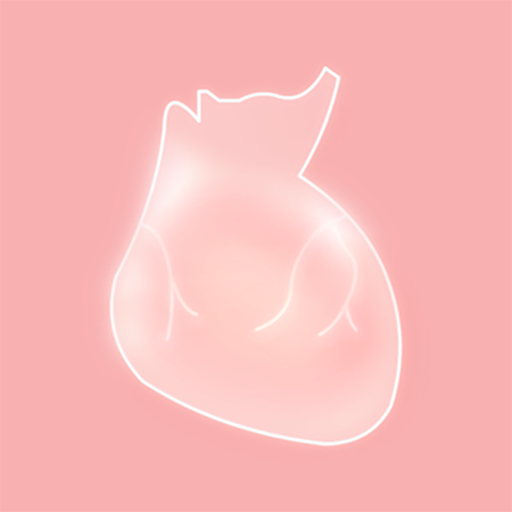

<div align="center">




# LifeBody·麦麦身体｜生理仿真引擎

**让麦麦不仅在聊天中存在，还有一副持续运转、会饿会困会生病的身体。**

装上之后，麦麦会有自己的心率、血压、血糖、饥饿曲线、睡眠质量等各种生理指标。根据吃的食物，睡眠质量，运动与否，通过仿真模型真实影响麦麦自身的感受。

心脑电图像 · 生理模型仿真 · 睡眠周期 · 情绪仿真

[](https://github.com/ShuangziG/maibot-body-emulator/releases)
[](https://docs.maibot.chat/)
[](https://github.com/Mai-with-u/maibot-plugin-sdk)
[](https://github.com/ShuangziG/maibot-body-emulator/blob/main/_manifest.json)
[](https://github.com/ShuangziG/maibot-body-emulator/blob/main/LICENSE)

[](https://github.com/ShuangziG/maibot-body-emulator/stargazers)
[](https://github.com/ShuangziG/maibot-body-emulator/commits/main/)
[](https://github.com/ShuangziG/maibot-body-emulator/issues)

[下载安装](https://github.com/ShuangziG/maibot-body-emulator/releases/latest) · [使用手册](docs/使用手册.md) · [配置指南](docs/配置指南.md) · [状态 API](docs/只读状态API.md) · [更新日志](CHANGELOG.md)

</div>

> **启用插件联动功能后，需重启 MaiBot 本体。**
>
> 联动开关只在插件加载时读取一次。在 WebUI 里打开「启用联动」后若不重启，
> 两边插件都显示正常却互不通讯——身体拿不到麦生活的作息与日程。

> **先说三件最要紧的事**
>
> 1. **引擎本体不消耗 token。** 生理计算是纯 Python，只用标准库，不联网、不用 GPU、不调模型。挂多久都不产生费用。
> 2. **唯一的模型调用在「听懂吃了什么」这一步**，而且能关掉（见第八节）。
> 3. **所有医疗数据都是模拟，不能用于医学判断。** 有健康问题请找医生。

---

## 一、你会看到什么

装好之后，宿主（MaiBot）里会多出这几块地方：

| 页面 | 内容                                                  |
| --- |-----------------------------------------------------|
| **麦麦此刻的身体** | 身体时钟、8 项核心体征、6 项体感、状态自述、吃过什么、事件流、近 12 小时曲线          |
| **体征时间线** | 6 / 12 / 24 / 48 小时生理曲线、按类型筛选的事件流、逐分钟采样回放表          |
| **内脏与食物库** | 实时ECG 心电与 EEG 脑电仿真、11 个系统共 73 项指标、311 种食物库、各餐段的候选菜单 |

三个页面都是单文件内联 HTML/CSS/JS，不引用 CDN、不发外部请求，**断网也能正常显示**。

---

## 二、安装

下载最新 Release，解压到宿主的插件目录，重启 MaiBot 即可。

完整的目录结构、依赖与验证步骤见 **[使用手册 · 安装](docs/使用手册.md)**。

---

## 三、身体里有什么

状态量一共 194 个，其中 73 项按 11 个系统分组展示。这些量是耦合着数值积分的，不是各走各的：

| 系统 | 能看到什么 | 怎么算的 |
| --- | --- | --- |
| 心血管 | 心率、每搏输出量、心输出量、血压、脉压、循环血量 | 交感/副交感张力 + 前后负荷 |
| 呼吸 | 呼吸频率、潮气量、血氧、动脉二氧化碳分压 | 按代谢产生的 CO₂ 负荷调通气 |
| 代谢 | 血糖、胰岛素、肝糖原、细胞能量、血乳酸 | 血糖四条去路：外周摄取（胰岛素依赖）、糖原储存（上限 800 g）、肾糖阈（>10 mmol/L）、质量作用（高出静息基线才生效）；糖原满位后溢出合成为脂肪（不入账） |
| 消化道 | 胃内容物、待排空的糖/蛋白/脂肪、肠内营养 | 胃排空 → 小肠分段吸收 → 入血 |
| 肠道腺体 | 胃泌素、促胰液素、缩胆囊素、GIP、PYY、GLP-1、胃饥饿素 | 按食物成分分泌，反过来调消化速度和食欲 |
| 肾脏 | 肾小球滤过率、尿量、膀胱容量、血钠钾、渗透压、血液 pH | 溶质负荷驱动尿量，钠排出随摄入自适应 |
| 内分泌 | 肾素、血管紧张素、醛固酮、皮质醇、肾上腺素、T3、抗利尿激素 | 带完整反馈链，随昼夜相位和应激变化 |
| 体温 | 核心体温、出汗、寒战、冷热体感 | 产热与散热双向调节 |
| 嗜好品 | 血液酒精浓度、咖啡因浓度 | 乙醇零级动力学，咖啡因一阶消除 |
| 行为体感 | 饥饿、口渴、压力、疼痛、精力、心境 | 胃扩张抑制食欲，血浆渗透压驱动口渴 |
| 受体占据 | 血管 α1、心脏 β1、迷走 M2、胰岛素受体 | 激素对受体的实际占据比例 |

表里是**能按器官归类**的量。另有几套机制不落在某个器官上，但在第四节单独说了：睡眠结构与睡眠债、月经双相位、延迟性肌肉酸痛（DOMS）。

---

## 四、没人管的时候它怎么活

不开启外部日程插件联动时，引擎按这套规则运行。

### 作息与睡眠

| 项目 | 规则 |
| --- | --- |
| 睡眠窗口 | 默认 23:00–07:00，上床后约 5 分钟过渡入睡；心率、血压、体温、呼吸一起下移，起床反向回升 |
| 睡眠结构 | 清醒 → 浅睡 → 深睡 → REM 四态循环，一个周期约 90 分钟，一夜 4–5 轮；深睡段心率与体温最低，REM 段脑电接近清醒但肌张力消失 |
| 睡眠债 | 按「实际睡了多久 vs 需要多久」结算，与睡眠窗口无关：**醒着超过 16 小时**才开始按小时累积；影响次日精力与运动意愿 |
| 强制入睡 | 连续清醒 ≥ **20 小时** 强制入睡，持续 **6 小时** 后自然醒，无视睡眠窗口（阈值本身是估算，依据 [R6]） |
| 夜间口渴 | 睡眠期口渴感知被抑制，整夜通常不喝水，只有重度缺水才会渴醒；整夜 0–1 次是常态 |
| 被吵醒 | 夜里收到消息会醒，醒来后需**连续安静 10 分钟**才重新入睡 |

### 吃饭与排泄

| 项目 | 规则 |
| --- | --- |
| 三餐 | **07:30 / 12:30 / 18:30**，到点就吃、不看饿不饿；吃什么从当前餐段的食谱池里选 |
| 加餐 | 饥饿 > 80 **且** 胃内容物 < 300 mL，并与正餐至少隔 **0.75 小时** |
| 正餐边界 | 饭点撞进睡眠就跳过，不会半夜起来偷吃；胃里超过 **600 mL** 不再吃正餐；睡觉不加餐 |
| 饮水 | 口渴过阈值且距上次饮水 > **20 分钟**才喝，属离散事件 |
| 排尿 | 阈值白天 **300 mL**、夜里 **550 mL**，另有 **600 mL** 硬上限兜底 |
| 排便 | 胃结肠反射：餐后 **30 分钟**内阈值下调；夜里除非残渣超过 **260 g** 否则不触发 |

### 昼夜节律与运动

| 项目 | 规则 |
| --- | --- |
| 昼夜节律 | 交感张力按 24 小时余弦摆动，最低约 **04:00**、最高约 **16:00** —— 下午血压天然比清晨高 |
| 运动门槛 | 需同时满足：精力 ≥ 55（先按睡眠债扣减）、最近睡眠 ≥ 6 小时、DOMS < 30；极端天气或生理期不判为要跑 |
| 运动强度 | **目前一律按慢跑**：60% HRmax ≈ 115 bpm，呼吸约 22 次/分，产热 +0.55 ℃（快跑档代码保留但不可达） |
| 心率恢复 | 停止后 1 分钟回落约 **19 bpm**，5 分钟基本回到静息；上升与恢复不对称（迷走撤退快、再激活慢） |
| 体温 | 运动峰值约 37.4 ℃，靠出汗蒸发回落到基线，不会因此被判「低烧」 |
| DOMS | 运动后 24 小时内爬升，48–72 小时达峰，72 小时后线性消退、约 7 天消失；与乳酸无关（[R3][R4][R5]） |

### 月经周期（默认关闭）

| 项目 | 规则 |
| --- | --- |
| 双相位 | 卵巢侧 卵泡期 → 排卵期 → 黄体期；子宫侧并行 增殖期 → 分泌期 → 行经期，两条相位都能在面板看到 |
| 激素 | 雌激素、孕激素、前列腺素随时间变化；行经期前列腺素上升带来痛经与 PMS |
| 对齐日历 | 在「上次月经第一天」填日期（如 `2026-11-05`），周期从那天起算；留空则从启用那刻累加；改完即时生效 |
| 关闭时 | 不推进周期、不产生疼痛，界面也不显示这些字段 |

**年龄相关**：最大心率用 Tanaka 公式 `208 − 0.7 × 年龄`，**内置常量 18**。

---

## 五、怎么跟它互动

三个入口：`body_state` 读身体状态、`body_eat` 记账吃喝、`/body` 在会话里出状态图；另有首页卡 `lifebody_card`。

参数、示例与注意事项见 **[使用手册 · 怎么跟它互动](docs/使用手册.md)**。

---

## 六、它会生病，但不会死

健康值是 0–100 的连续量，**没有死亡状态**。掉到 0 只代表状况很糟，休养和治疗能拉回来。

这些开关都在配置面板的 **「急救」** 分组里：

| 开关 | 默认 | 作用 |
| --- | --- | --- |
| 启用自动送医 | 关 | 总开关；关着时健康照算，但不会自动送医 |
| 濒死健康阈值 | 25 | 健康值低于它就算病重 |
| 濒死持续判定 | 600 秒 | 病重持续多久才送医；0 = 立刻送 |
| 住院时长 | 6 小时 | 一次住院待多久 |
| 出院恢复健康值 | 74 | 出院时健康值回到多少 |
| 住院静默时长 | 0 小时 | 住院头几小时不回消息；0 = 不拦 |

流程是：跌破阈值 → 观察期 → 没恢复 → 送医。住院期间给支持治疗，血糖、血氧、血压、体温、体液逐步回到安全区，健康值向「出院恢复健康值」收敛，然后出院。

送医原因会按当时最严重的那一项写，比如「严重低血糖 2.8 mmol/L」「低氧血症 86%」「循环衰竭 MAP 52」「超高热 39.8 ℃」。

**默认关闭。** 防止聊着聊着麦麦进医院了，所以 `enabled = false`：健康值照样计算，但不会自动送医，也不会掉到负数，麦麦靠喝水、吃饭、休息自己缓过来。想让它在病重时自动送医，把这一项改成 `true` 即可，下面的阈值和住院参数才生效。

---

## 七、和日程插件联动（麦生活 / 麦织，可选）

装了 **麦生活**（`maibot-community.mai-life`）或 **麦织**（`ilworkcn.maiweave`）任意一个，都可以让身体跟着它真实的日程走。两者互不兼容，装哪个就把「日程引擎」填成哪个。**默认关闭**，不装也完全能用，但无法完全发挥能力。

这些开关都在配置面板的 **「日程联动」** 分组里（想直接改 `config.toml` 的话，字段名见 [配置指南](docs/配置指南.md)）。

| 开关 | 效果 |
| --- | --- |
| 日程引擎 | **麦织填 `weave`，麦生活填 `life`**。`life` 打麦生活的 `get_life_state` / `get_current_scene`；`weave` 打麦织的只读 `get_life_status`。插件 ID 由它自动决定（`life` → `maibot-community.mai-life`，`weave` → `ilworkcn.maiweave`），不需要另外填；填错则联动一直失败、身体退回独立运行。 |
| 同步作息 | 深睡时交感张力降到清醒的三分之一左右，心率约 45–50；上班通勤场景小幅上调。关掉就只按内置昼夜节律走。 |
| 同步三餐 | 关掉用内置饭点；打开后三餐时刻和餐段由日程定。日程摘要里点名的食物（「点了一份生榨米粉配油条」）会被识别写入；认不出的按餐段食谱池选。同一顿饭只触发一次，跨重启不重复（麦织下用计划 ID + 开始时间去重）。 |
| 体征注入对话 | 宿主请求模型前，把当前生理状态压成一句「【你此刻的身体】…」拼进系统消息末尾，让麦麦更清楚自己的身体。**两个前置条件**：①「启用联动」打开，联动关着时本开关完全不生效；② **只在有异常项时才注入**——健康 <70、血糖越界、3 小时内刚吃过、饥饿 >45、口渴 >55、精力 <45、住院中，任一成立才生成文字，全都正常时注入为空、不花 token。代价是触发时每次几十到二百 token。 |
| 时钟对齐 | 拿麦生活时钟补仿真钟点的相位差。只修钟点，不动已累计的生理时长，校正瞬间不会心率血压跳变。**仅麦生活**。 |
| 病危时通知麦生活 | 住院或首次进入濒危时，把这件事交给麦生活，让它有由头主动来找你说话（由麦生活自己决定何时聊）。每类事件只发一次，出院不补发。**这是本插件对麦生活唯一的写接口**，不会给模型注入任何内容；**仅麦生活**，麦织没有对应接口。 |

**两个引擎的写回方向不一样**：麦生活是「读 + 一处写」——除了读状态与场景，还能通过「病危时通知麦生活」交给它一条主动联系契机（默认关闭）；麦织则是**纯单向**，只有 `get_life_status` 一条只读接口，不写入、不改动它任何东西，也不 import 它的模块。它的 kind 比麦生活多出 `cook` / `social` / `diary` 三种，已单独映射到活动强度；它的 `energy`（0–100）和 `mood`（−5~5）与麦生活量纲不同，这两个字段**不透传**——量纲不明的值会把心率和心境带偏，宁可留中性。

麦织模式下会静默跳过的能力：日程运动识别、时钟对齐、主动分享、天气定位提示（麦织没有对应接口，失败即降级，不影响生理推进，也不会报错）。

三条设计约束：

1. 只走对方的公开接口（`@API(public=True)`），不读数据库、不依赖内部结构、也不 import 它的模块。对方升级不会把身体状态搞坏。
2. 对方没开、版本不对、请求超时——一律静默降级：身体用上一次的有效值或自己的时钟继续走，不报错不中断。
3. 状态拉取在独立后台循环里，不进仿真步进。网络抖动不会让生理量跳一格。

---

## 八、关于 token：模型调用与体征注入

食物识别分两段。

**第一段，本地关键词。** 内置 473 条叫法映射，覆盖 311 种食物（「米饭」「螺蛳粉」「奶茶」「宫保鸡丁」……），能直接命中具体食物。命中就够了，全程本地完成，**不调模型**。

**第二段，模型拆解。** 只有两种情况会交给宿主内置的 utils 轻量模型：一是关键词一样都没认出来（表外菜名，如「外婆家的私房菜」）；二是只认出一项、而那一项不是精确食物——比如「粥」只能认出 Rice，需要模型补主食。像「奶茶」「红烧肉」「螺蛳粉」这类本表已有精确食物的，直接落地，不调模型。模型结果与关键词结果**取并集**：模型可能漏掉文本里明写的名词，关键词可能把复合菜名归并成一个，两边互补。

触发条件卡得很死：

- 只在**真实进食**时调（外部写入，或联动模式下麦生活日程触发三餐），不随仿真步进调。
- 关键词已命中 ≥ 2 项就跳过模型；精确食物也跳过。
- 超时（默认 20 秒）、返回异常、宿主没给 llm 能力——回落到关键词结果，进食事件照常写进模型。
- 生理仿真本身零模型调用，血糖怎么变、胃怎么排空，全是本地数值算出来的。

**体征注入不调模型，但会给已有请求加长上下文。** 打开 `「日程联动 · 体征注入对话」` **（且联动开启）** 后，插件会在宿主请求模型前把当前体征压成一句「【你此刻的身体】…」拼进系统消息；健康、血糖、饥饿、口渴、精力都正常时不生成文字，**一分 token 都不花**。只有命中异常项时才出现，量级几十到二百 token。

`「聊天喂食 · 允许聊天喂食」` **默认关闭。** 这条路径会把聊天内容写进生理模型，属于需要使用者主动开启的能力；关着的时候三餐仍按内置饭点（或麦生活联动）自主发生，身体不会饿坏。想彻底零模型交互，保持「允许聊天喂食」关闭、且不启用「同步三餐」，插件就是纯本地程序。

---

## 九、配置速查

所有开关都在插件的配置面板里，也可以直接改插件目录下的 `config.toml`（首次加载时按默认值自动生成）。

完整字段、默认值与逐项说明见 **[配置指南](docs/配置指南.md)**。

---

## 十、初始状态与存档

新建存档时是**满状态开局**：按早上 8 点初始化——心率 70、血压 120/80、血糖 5.0、体温 36.8 ℃、不饿不渴、胃里空、当天没排过、精力充沛。

不过「仿真与存档 · 跟随系统时钟」默认是开的，插件启动后会把仿真钟点立即对齐真实系统时间，所以打开面板看到的通常是**当前真实时刻**，「早上 8 点」只管开户那一瞬。想让它固定从 8 点开始走，把这一项关掉。

**已有存档时不会重新初始化**：身体相位、上次钟点、联动去重记录都从存档读回，升级不会让整条昼夜曲线偏掉。

存档在 `<data_dir>/body_state.json`，装着状态快照、最近 600 个采样点、最近 200 条事件和当日计数基准。写入是先写临时文件再原子替换，**中途断电不会留半截文件**。

> **删掉这个文件 = 重置身体**，下次启动按初始状态重来。

---

## 十一、已知局限

这些是建模上的取舍，不是 bug：

| 问题                               | 原因                                                                                                              |
|----------------------------------|-----------------------------------------------------------------------------------------------------------------|
| **酒精峰值偏低**                       | 伏特加峰值血醇约 0.20 g/L，参考区间 0.25–0.30，因为用了单室吸收模型。                                                                    |
| **咖啡因只建模了消除相**                   | 半衰期取 5 小时，没有耐受和戒断，长期喝不会提高需求量。                                                                                   |
| **膳食钠偏低**                        | 默认食谱约 51 mmol/日，靠 60 mmol 下限兜底，真实饮食通常更高。                                                                        |
| **食物份量是通用营养估值**                  | 311 种食物的分类与消化链路完整，但每份克数来自 USDA 与《中国食物成分表》的常见份量估算（B 级），不是实验室真值。                                                  |
| **没有体重体脂建模**                     | 只保留「刚吸收待氧化的脂肪」这个中间量，不构成体脂库，所以不体现体重变化。                                                                           |
| **体温不受环境温度影响**                   | 没有室内外温度输入，只由自身产热散热决定。                                                                                           |
| **血压没有长期重构**                     | 长期高钠不会产生血管结构变化，只体现为当次的容量和阻力变化。                                                                                  |
| **睡眠四态占比是估算**                    | 90 分钟周期与各态比例取自通用区间，没有逐夜实测支撑；睡眠债按小时线性累积，也没做个体差异。                                                                 |
| **「连续睡眠 ≥4 小时才算一夜」是工程取舍，不是文献结论** | 文献中不存在这个阈值，它的作用只是把午睡挡在「昨晚睡了多久」的统计之外。同理「近 7 日汇总」是 PSQI 成分的周度类比，PSQI 官方回顾窗口是 1 个月，本插件不称它为 PSQI。                   |
| **月经激素曲线是形态近似**                  | E2/P4 的形状按生理常识搭，不是定量内分泌模型；痛经强度由前列腺素线性映射，未考虑个体差异与用药。                                                             |
| **DOMS 不区分肌群**                   | 只建模整体酸痛程度，所以「今天只有腿疼」这种情况不体现。                                                                                    |
| **血糖峰值比真人来得晚**                   | 餐后峰值约在 60~70 分钟，真实生理约 45~50 分钟。原因是消化道按「胃→十二指肠→空肠→糖池→血」五段串联建模，每段各有延迟，叠加后整体后移；胃排空也用了体积一阶衰减，没有做真实的分相排空。            |
| **精制碳水峰值**                       | 白米饭（56 g 净碳水）单吃时峰值约 6.6 mmol/L（v1.2.4 之前约 8.3），健康人参考值 6~7.5，目前落在区间内；但份量与餐次叠加仍会上移——实测两顿米饭叠加约 8.1、连续三天三餐高碳水约 9.2。 |
| **胰岛素量纲是相对值**                    | 模型的 `insulin` 是 0~2.2 的相对量纲，不是 μU/mL，因此文献里以 μU/mL 给出的定量结论（如肝糖输出半抑制 29 μU/mL）无法直接代入，只能作方向性参考。                    |
| **没有酮体通路**                       | 连续低碳水饮食时，模型只能靠糖异生维持血糖，实测 30 天低糖饮食谷值可到 4.17 mmol/L。真实生酮适应下大脑与肌肉改用酮体供能，血糖下限不会这么低。                                 |
| **脂肪合成只做转换、不建账**                 | 糖原满位后多余的葡萄糖会按 Acheson 1988 的量级合成为脂肪并从血糖里扣除，但产出的脂肪直接丢弃，不进入体脂、血脂或胰岛素抵抗任何通路。因此长期超额碳水的后果在模型里不会显现。                   |
| **年龄不可配置**                       | 心率已经按 Tanaka 公式（208 − 0.7 × 年龄）算，但年龄是引擎内置常量 **18**，面板里改不了。跟着年龄走的还有静息基线（18 岁日间 73、深睡 61；60 岁日间 82）。              |
| **运动不区分烈度**                      | 日程只能回答「要不要跑」，给不出配速与间歇结构，所以**所有运动一律按慢跑处理**（60% HRmax，约 115 bpm）。三档强度的代码保留，但目前只有慢跑可达。                             |

---

## 十二、故障排查

插件频繁重载、联动失效、存档异常等常见故障的定位与处置见 **[使用手册 · 故障排查](docs/使用手册.md)**。

---

## 十三、常见问题

关于 token 消耗、数据准确性、要不要装麦生活等问题的回答见 **[使用手册 · 常见问题](docs/使用手册.md)**。

---

## 十四、给其他插件的公开 API

对外提供 7 个 `public=True` 接口：`drunk_snapshot` / `log_drink` / `log_meal` / `get_state` / `get_clock` / `list_foods` / `adjust_mood`，供厨房、醉酒等插件调用。

完整签名、返回结构、单位与契约见 **[只读状态 API](docs/只读状态API.md)**。

---

## 十五、酸碱与运动通气：模型依据

本节只讲结论与依据编号，不重复列题录。

### 三条核心结论

| 结论 | 依据 | 模型如何落地 |
| --- | --- | --- |
| 运动通气的执行器官是**潮气量**，不是呼吸频率。单独提高呼吸频率会**增加死腔通气**并导致 CO₂ 潴留 | [R11] Nicolò 2018 | 被控量设为肺泡通气量 VA，反解 `tidal = VA*1000/rr + 150` |
| 运动时 PaCO₂ **维持静息水平**（至接近极量），不会升到 59 | [R13] Stickland 2013 | 运动中 `pco2_set = 38.5 mmHg` |
| 运动性酸中毒是**代谢性**的：乳酸被缓冲体系吸收，pH 会真实下降到 7.1~7.3 | [R12] Whipp 1989、[R13] | 乳酸降低碱剩余，再由 Van Slyke 方程反解 pH |
| 血液缓冲**不止碳酸氢盐**：血红蛋白、血浆蛋白、磷酸盐都会吸收 H⁺，使同样酸负荷下 pH 少掉一部分 | [R14]、[R15] | Van Slyke 方程把非碳酸氢盐缓冲折算进碱剩余 |

> 本节引用的 [R11]–[R15]：完整题录见文末「参考文献」表，每条文献的取用内容见 [`REFERENCES.md`](REFERENCES.md)。

### 血液缓冲对：不只是碳酸氢盐

血液的缓冲是**多对并联**的，碳酸氢盐只是其中容量最大的一对：

| 缓冲对 | 位置 | 作用 | 本模型如何处理 |
| --- | --- | --- | --- |
| HCO₃⁻ / H₂CO₃ | 血浆 | 容量最大，CO₂ 可经肺排出（开放系统） | 显式状态量 `hco3` |
| Hb / HHb | 红细胞内 | **全血缓冲容量的重要组成**，组氨酸咪唑基 pKa≈6.8 | 经 Van Slyke 折算进碱剩余 |
| 血浆蛋白 | 血浆 | 贡献较小 | 同上 |
| 磷酸盐 | 血浆/细胞内 | 贡献最小 | 同上 |

**为什么不能只算 HCO₃⁻**：若让碳酸氢盐独自承担全部酸负荷，同一次酸中毒会被放大近一倍。实测对照（乳酸 10 mmol/L）：

| 算法 | pH | 说明 |
| --- | --- | --- |
| 仅碳酸氢盐（1:1 消耗） | 7.194 | 低估了其他缓冲对的贡献 |
| 完整缓冲（Van Slyke） | 7.285 | 与实测 7.30 吻合 |

实现方式是**碱剩余（base excess, BE）**：把所有缓冲对吸收完酸之后「还剩多少碱」压缩成一个标量，再由 BE 与 pCO₂ 反解 pH。这样非碳酸氢盐缓冲会被自动计入，不需要逐个建模。

```
BE = 0.885 × ((HCO₃⁻ − 24.4) + 40.0 × (pH − 7.40))
BE = 肾代偿增量 − 乳酸负荷
由 BE 与 pCO₂ 二分求解 pH，再由 pH 反算 HCO₃⁻（保持自洽）
```

> 式中 40.0 是**体内有效**非碳酸氢盐缓冲当量，属经验标定：标准碱剩余（Hb 取 5 g/dL）只覆盖细胞外液，而人体约 60% 的缓冲发生在细胞内。标定目标是让运动性酸中毒幅度与实测吻合（乳酸 10 → pH≈7.29，实测 7.30）。

### 缓冲会不会耗尽

会。碳酸氢盐被持续消耗后，pH 下降会加速（缓冲能力随底物减少而衰减）；本模型的 HCO₃⁻ 下限为 2.0 mmol/L、pH 下限钳在 6.80，与「严重酸中毒已超出代偿能力」的生理事实一致，不会出现负浓度或数值发散。

### 告警阈值为什么随运动状态变化

真实人重运动时 pH 会生理性降到 7.1~7.2，这是**正常代偿而非病理**。若用固定阈值 7.30，每一次正常运动都会被报成「酸中毒」。因此：

| 状态 | 酸中毒告警阈值 | 理由 |
| --- | --- | --- |
| 运动中 | < 7.10 | 乳酸性酸中毒属预期；只报真正危险的重度酸中毒 |
| 运动后 30 min 内 | < 7.20 | 乳酸半衰期约 25 分钟，恢复期仍偏低 |
| 静息 | < 7.30 | 常规阈值；此时低 pH 多为病理性（如脓毒症性乳酸酸中毒） |

> 阈值本身是**工程取值，不是文献阈值**。乳酸与碱剩余的 1:1 当量关系取 Stewart/强离子差框架的教科书结论（每 1 mmol/L 乳酸 = 强离子差降 1 mEq/L），未找到一手测定文献；非碳酸氢盐缓冲当量 40.0 为经验标定值，两者详见 [`REFERENCES.md`](REFERENCES.md) 的估算标注表。

---

## 十六、数据来源与免责

| 项目 | 说明 |
| --- | --- |
| 设计灵感 | LIFE（THIX 出品，<https://thix.co/life>）。器官、激素、受体占据的可观测维度参考了它，本插件是同方向的独立实现。 |
| 生理逻辑 | 完全自行实现，非反编译、非移植。血压、血糖、肾滤过、激素反馈的方程依据公开生理学常识与量纲关系构建，参数以结果落进生理范围为准。 |
| 食物数据 | 311 种食物（23 项 APK 原生 FoodType + 288 项中式日常扩展）的份量、热量、三大营养素按 USDA FoodData Central 与《中国食物成分表（第 6 版）》的常见份量估算填写，**不取自 LIFE 的原始数值表**。扩展表的热量由 `4×碳水 + 4×蛋白 + 9×脂肪 + 7×酒精` 反推，避免营养素与热量自相矛盾。 |
| 天气数据 | Open-Meteo 公开接口（实时温度、相对湿度、风速），城市名自动地理编码。 |
| 酸碱平衡 | 呼吸性分量由 Henderson-Hasselbalch 方程给出（HCO₃⁻ 与 pCO₂ 共同决定 pH）；代谢性分量按乳酸消耗 HCO₃⁻ 建模。运动通气的**被控量是肺泡通气量**，由它反解潮气量——单独提高呼吸频率只会增加死腔通气，见 [R11]。 |
| 已知偏差 | 见第十一节。 |

### 参考文献

被代码实际引用的文献，编号与 [`REFERENCES.md`](REFERENCES.md) 一致：

| 编号 | 文献 | 支撑哪部分 |
| --- | --- | --- |
| [R1] | Devlin J, et al. Blood lactate clearance after maximal exercise depends on active recovery intensity. *J Sports Med Phys Fitness*. 2014;54(3):271-278. PMID 24739289 | 血乳酸清除随恢复强度变化 |
| [R2] | 血乳酸半衰期 25 分钟 —— **科普转述，尚无一手文献** | 乳酸清除时间常数 |
| [R3] | Cheung K, et al. Delayed onset muscle soreness: treatment strategies and performance factors. *Sports Med*. 2003;33(2):145-164. PMID 12617692 | DOMS 与乳酸无关、影响运动表现 |
| [R4] | Hotfiel T, et al. Advances in Delayed-Onset Muscle Soreness (DOMS): Part I. *Sportverletz Sportschaden*. 2018;32(4):243-250. PMID 30537791 | DOMS 48–72 小时达峰 |
| [R5] | Doma K, et al. The Repeated Bout Effect of Multiarticular Exercises. *J Strength Cond Res*. 2023;37(12):2504-2515. PMID 38015738 | 重复运动效应（习惯抑制酸痛） |
| [R6] | Durmer JS, Dinges DF. Neurocognitive consequences of sleep deprivation. *Semin Neurol*. 2005;25(1):117-129. PMID 15798944 | 微睡眠与强制睡眠机制 |
| [R7] | Freckmann G, et al. Continuous glucose profiles in healthy subjects under everyday life conditions and after different meals. *J Diabetes Sci Technol*. 2007;1(5):695-703. PMID 19885137 | 餐后血糖峰值时点定标 |
| [R8] | Shah VN, et al. Continuous Glucose Monitoring Profiles in Healthy Nondiabetic Participants. *J Clin Endocrinol Metab*. 2019;104(10):4356-4364. PMID 31127824 | 健康人血糖正常区间 |
| [R9] | Vlachos D, et al. Glycemic Index (GI) or Glycemic Load (GL) and Dietary Interventions. *Nutrients*. 2020;12(6):1561. PMID 32471238 | GI 决定速率、GL 决定幅度 |
| [R10] | Rizza RA, Mandarino LJ, Gerich JE. Dose-response characteristics for effects of insulin on production and utilization of glucose in man. *Am J Physiol*. 1981;240(6):E630-E639. PMID 7018254 | 肝糖输出比外周摄取更敏感（结论备查） |
| [R11] | Nicolò A, Girardi M, Bazzucchi I, Felici F, Sacchetti M. Respiratory frequency and tidal volume during exercise: differential control and unbalanced interdependence. *Physiol Rep*. 2018;6(21):e13908. doi:10.14814/phy2.13908. PMID 30393984 | 运动通气由潮气量主导；单独提高呼吸频率会增加死腔通气 |
| [R12] | Whipp BJ, Davis JA, Wasserman K. Ventilatory control of the 'isocapnic buffering' region in rapidly-incremental exercise. *Respir Physiol*. 1989;76(3):357-367. doi:10.1016/0034-5687(89)90076-5. PMID 2501844 | 等碳酸缓冲段：乳酸被 HCO₃⁻ 缓冲产生的 CO₂ 被通气排出，PaCO₂ 不降 |
| [R13] | Stickland MK, Lindinger MI, Olfert IM, Heigenhauser GJF, Hopkins SR. Pulmonary Gas Exchange and Acid-Base Balance During Exercise. *Compr Physiol*. 2013;3(2):693-739. doi:10.1002/cphy.c110048. PMID 23720327 | 运动时 PaCO₂ 维持静息水平至接近极量；运动性酸中毒以代谢性为主 |
| [R14] | Siggaard-Andersen O. The van Slyke equation. *Scand J Clin Lab Invest Suppl*. 1977;146:15-20. doi:10.3109/00365517709098927. PMID 13478 | 碱剩余 BE ↔ pH ↔ HCO₃⁻ 的换算（血气仪通用口径） |
| [R15] | Krbec M, Waldauf P, Zadek F, Brusatori S, Zanella A, Duška F, Langer T. Non-carbonic buffer power of whole blood is increased in experimental metabolic acidosis: an *in-vitro* study. *Front Physiol*. 2022;13:1009378. doi:10.3389/fphys.2022.1009378 | 非碳酸缓冲（血红蛋白/血浆蛋白/磷酸盐）限制 pH 波动 |
| [R16] | *Advances in Physiology Education*. 2024. doi:10.1152/advan.00023.2024；ProSciento/KBI 高胰岛素钳夹资料 | 肝糖原约 100 g、肌糖原约 400 g；最大葡萄糖处置率 M 值 9~12 mg/kg/min |
| [R17] | Bergman 最小模型的葡萄糖有效性 S_G（**二手综述口径**，常见 0.01~0.03 /min） | 不依赖胰岛素的质量作用去路；本模型取 0.020 /min |
| [R18] | Acheson KJ, Schutz Y, Bessard T, Anantharaman K, Flatt JP, Jéquier E. Glycogen storage capacity and de novo lipogenesis during massive carbohydrate overfeeding in man. *Am J Clin Nutr*. 1988;48(2):240-247 | 糖原增益约 500 g 后净脂肪合成才开始；约 475 g 碳水/天 → 150 g 脂肪/天，且血糖未异常升高 |
| [R19] | Silva LRBE, Zamunér AR, Gentil P, et al. Cardiac Autonomic Modulation and the Kinetics of Heart Rate Responses in the On- and Off-Transient during Exercise. *Front Physiol*. 2017;8:542；HRR1 常模、运动核心温度综述、StatPearls 体温调节 | 心率上升/恢复不对称；HRR1 15~25 bpm；剧烈运动核心温度 38.3~39.4 ℃；散热靠出汗蒸发 |
| [R20] | Tanaka H, Monahan KD, Seals DR. Age-predicted maximal heart rate revisited. *J Am Coll Cardiol*. 2001;37(1):153-156；AHA/Mayo 静息与睡眠心率常模；Zone 2 强度区间 | HRmax = 208 − 0.7 × 年龄（18 岁 ≈195）；成人静息 60~100、睡眠 45~70；慢跑 = 60~70% HRmax |

每条文献的**取用内容**、查阅方式与「估算」标注见 [`REFERENCES.md`](REFERENCES.md)；血糖与睡眠的数值核对与未核实清单见 [`血糖与睡眠文献依据.md`](docs/血糖与睡眠文献依据.md)。

本插件不是医疗器械，也不是教学工具。**所有医疗数据均为模拟，不能用于医学判断和诊断。任何健康问题请咨询执业医师。**

---

## 十七、作者与许可

| 署名 | 职责 |
| --- | --- |
| Evil双子 | 设计、需求定义与验收 |
| DeepSeek | 实现与文档 |

MIT
